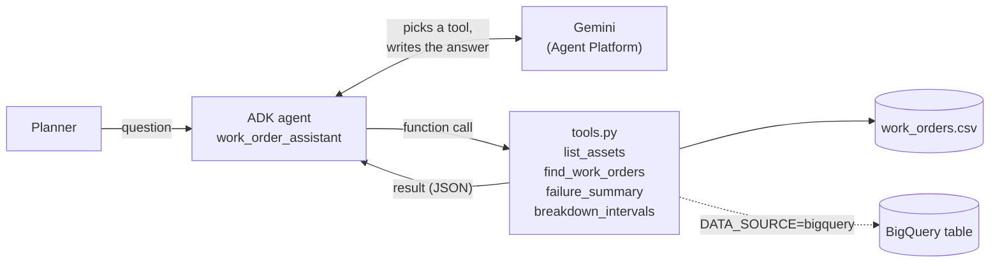

# Work-order assistant: an ADK agent on Gemini

[](https://github.com/devpatram/gemini-workorder-agent/actions/workflows/ci.yml)


A maintenance planner asks about a machine in plain English ("what keeps failing on Crimper 1?"). The agent answers from
the work-order history through four tested Python tools, and it cites the work orders it used, so the planner can check
every number.

Built with Google's [Agent Development Kit (ADK)](https://google.github.io/adk-docs/) and Gemini on Google Cloud
(Gemini Enterprise Agent Platform, formerly Vertex AI). The data can come from a CSV file or from BigQuery.

> **All data here is made up:** 50 work orders for 6 assets on a fictional production line, Nov 2025 to Oct 2026.

## How it works



1. The planner's question goes to the agent, which ADK runs and keeps the session for.
2. Gemini reads the question and the tool descriptions and picks a tool with arguments.
3. ADK calls the Python function. The function reads the data and does the matching, filtering and arithmetic.
4. The result goes back to Gemini, which writes a short answer and cites the work orders.

**The model never touches the data and never does arithmetic.** It decides and it writes. The numbers come from Python,
where they are tested.

## Design choices

| Choice | Why |
| --- | --- |
| The tools hold the logic | Counts, hours, costs and intervals are computed in Python and covered by tests. A model can slip on a sum. |
| Every answer cites work orders | A planner can open WO4147 and check. An answer without evidence is not useful on a plant floor. |
| Tools return a status | `ok`, `not_found`, `ambiguous` or `error`. "Extruder" matches two assets, so the agent asks which one instead of guessing. "Boiler 7" is not found, and it says so. |
| Docstrings are written for the model | ADK sends each function's name, arguments and docstring to Gemini as the tool description. A test checks that every tool has one. |
| One setting switches CSV to BigQuery | The tool is the seam: swap the data source, keep the agent. |
| The model is configurable | Gemini versions are retired on a schedule. `scripts/check_model.py` finds one that answers in your project and writes it to `.env`. |
| Limits are stated | `breakdown_intervals` is calendar days between breakdown orders, not a reliability model. The instruction tells the agent to say so. |

## Example questions

The figures below are what the tools return for the sample data. Gemini's wording varies; the numbers and order
numbers should not.

| Ask | What a right answer contains |
| --- | --- |
| Which assets have the most work orders? | Crimper 1 (11), Cooling Pump P3 (10), Capstan A (9), Extruder 2 (8), Extruder 1 (6), Take-up 2 (6) |
| What keeps failing on Crimper 1? | Hydraulic hose: 6 of 7 breakdowns, 16.5 labor hours, $2,157.50 (WO4147, WO4140, WO4131, WO4115, WO4103, WO4101) |
| How often does Crimper 1 break down? | About every 50.5 days on average (gaps of 6 to 101 days), last on 2026-09-10, with the note that this is calendar time, not run time |
| What fails most on the cooling pump? | Mechanical seal: 6 of 8 breakdowns, $1,742.50 |
| Show me the Extruder history. | A question back: Extruder 1 or Extruder 2? |
| What about Boiler 7? | No work orders found, and an offer to list the assets |

## Run it

You need a Google Cloud project with billing and the `gcloud` CLI. Cloud Shell has everything.

```bash
git clone https://github.com/devpatram/gemini-workorder-agent.git
cd gemini-workorder-agent
python3 -m venv .venv && source .venv/bin/activate
pip install -r requirements.txt -r requirements-dev.txt
pytest -q                                    # the tools only: no cloud, no model

gcloud config set project YOUR_PROJECT_ID
gcloud services enable aiplatform.googleapis.com
gcloud auth application-default login        # not needed in Cloud Shell
cp .env.example workorder_agent/.env
sed -i "s/your-project-id/$(gcloud config get-value project)/" workorder_agent/.env
python3 scripts/check_model.py               # finds a Gemini model that answers and saves it to .env

adk run workorder_agent                      # chat in the terminal
adk web                                      # or the web UI with the trace of every tool call
```

`aiplatform` is still the API's name after the rename to Agent Platform.

**In Cloud Shell,** run `adk web --port 8080` and open Web Preview on port 8080. If the page stays blank and the
terminal shows `403 Forbidden`, restart it with that preview address allowed (the exact origin, not `*`):

```bash
adk web --port 8080 --allow_origins="https://8080-cs-....cloudshell.dev"
```

## Read from BigQuery

```bash
gcloud services enable bigquery.googleapis.com
python3 scripts/load_bigquery.py             # creates dataset "workorders" and loads the 50 rows with typed columns
sed -i "s/^DATA_SOURCE=.*/DATA_SOURCE=bigquery/" workorder_agent/.env
adk run workorder_agent                      # same questions, same answers
```

The table name comes from `BQ_TABLE` in `.env`, never from the user or the model. A test runs the tools on BigQuery-typed
rows (real dates and floats) and checks the answers match the CSV.

## Deploy

ADK packages the `workorder_agent` folder, including its `requirements.txt` and `.env`:

```bash
# Agent Runtime (formerly Agent Engine): managed hosting and sessions
adk deploy agent_engine --project=YOUR_PROJECT_ID --region=us-central1 \
    --display_name="Work-order assistant" workorder_agent

# or Cloud Run, with the web UI
adk deploy cloud_run --project=YOUR_PROJECT_ID --region=us-central1 --with_ui workorder_agent
```

Flags change between ADK releases, so check `adk deploy agent_engine --help` first. Deploy with `DATA_SOURCE=csv` unless
the service account the agent runs as can read the BigQuery table. Give that account read access to that one table and
nothing more. Delete what you deploy when you are done, and check the bill the next day.

## Tests

```bash
pytest -q
```

Ten tests run in GitHub Actions on Python 3.11 and 3.12, with no Google Cloud account:

- The sample history: 50 orders, 6 assets.
- Matching: exact names, case, partial names, `not_found` for an unknown asset, `ambiguous` when a partial name matches
  two assets, `error` for a bad order type.
- Arithmetic: the hydraulic-hose totals for Crimper 1 and the breakdown intervals.
- BigQuery-typed rows give the same answers as the CSV.
- Every tool has a docstring with a `Returns:` section, because that text is what the model reads.

The agent itself (Gemini's choices and wording) is checked by asking the example questions above. A next step is an
ADK evaluation set (`adk eval`) built from those questions.

## Layout

```
workorder_agent/
  agent.py            the ADK agent: model, instruction, tools (adk looks for root_agent here)
  tools.py            the four tools: plain Python, no model
  data/work_orders.csv
  requirements.txt    what the deployed agent installs
scripts/
  check_model.py      finds a Gemini model that answers in your project
  load_bigquery.py    loads the CSV into BigQuery
tests/test_tools.py
.env.example          settings; copy to workorder_agent/.env
```

## What it does not do

- It is read-only. It never opens, changes or closes a work order.
- It is not a reliability model. No run hours, censoring or Weibull fits.
- `adk web` is a development UI with no sign-in. Do not expose it publicly.

## License

MIT. See [LICENSE](LICENSE).
